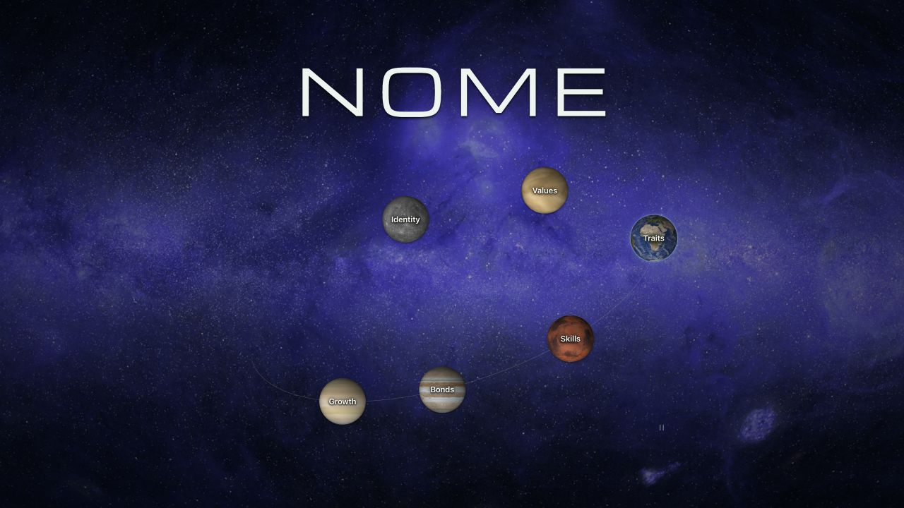

# NOME

让 Agent 了解你，并由你决定记住什么。

NOME 是支持 Codex 和 Claude Code 的本地 Skill。从已有记忆建立个人档案，通过全面梳理和持续问答补充了解，在你明确要求时保存。六个领域直接使用 Markdown 文档，浏览器以个人星图组织阅读。



*界面预览使用虚构演示数据。*

需要 **Node.js 22+** 和本地 Agent 的文件、终端访问权限。无额外模型 API、数据库、npm 运行依赖或云端服务。NOME 自身不上传个人数据；Agent 如何处理读取内容由其宿主决定。

## 安装

```sh
git clone https://github.com/ZihaoZhang0131/NOME.git
cd NOME
node skills/nome/scripts/nome.mjs install --agent codex
```

可选 `--agent claude` 或 `--agent both`。默认安装到 `~/.agents/skills/nome/` 和 `~/.claude/skills/nome/`。无需 npm install；安装不读取或导入个人资料。私有仓库需要 GitHub 访问权限。

在后续 Agent 对话中使用：

- Codex：`$nome 初始化我的个人档案`
- Claude Code：`/nome 初始化我的个人档案`
- 继续梳理：`进入 NOME 问答模式，全面梳理我的经历与变化。`
- 保存：`把刚才聊过的内容整理入库。`
- 更新：`帮我更新个人档案：我现在每周可以拿出四小时学习。`
- 查看：`帮我启动 NOME 可视化页面。`

隐式触发取决于宿主的技能发现机制；未触发时直接指名 NOME。

## 初始化与问答

初始化优先使用已注入的个人记忆、宿主公开能力和受支持的本地记忆来源。没有可读内容时，Agent 会让你选择指定其他来源，或直接开始补充。可以指定文件、文档或 ChatGPT 网页版记忆摘要；网页读取依赖宿主可用的浏览器和登录状态。

Codex 的本地适配包括已知 Markdown 索引及 memories_1.sqlite 中受支持的记忆摘要表，读取范围有限，不代表全部历史。SQLite 使用 Node 内置能力；该能力不可用或结构未适配时会明确报告。Claude 检查用户和当前项目的 CLAUDE.md，auto memory 目录需明确提供。不会遍历其他项目或全部聊天。

问答先回顾已有内容，再建立模块的整体脉络。经历与变化从成长背景、童年与青少年、求学或进入社会、成年与工作、近期变化逐步展开，不要求用一个小事例概括整个人生。已有较完整内容时，先介绍现状，再讨论最近的更新。可以随时跳过、暂停或长篇讲述。

普通聊天不自动保存。明确说“整理入库”或“保存这一段”即可保存范围清楚的内容，不重复确认。入库就是正式正文，没有待核实、推测或草稿状态。未解决的冲突留在对话，不写进页面。

## Markdown 档案

默认数据目录为 `~/.nome/`，可用 `NOME_DATA_DIR` 或 `--data-dir` 指定其他位置。

```text
~/.nome/profile/
  identity/index.md       身份与处境
  motivation/index.md     动机与价值
  traits/index.md         特质与偏好
  capabilities/index.md   能力与经验
  relationships/index.md  关系与连接
  growth/index.md         经历与变化
```

每个领域默认一份完整文档，较长时拆分章节，在 index.md 中以相对链接组织顺序。Agent 与页面读取同一套文件，手动修改后刷新即可看到变化。没有内容的领域可留空。

正文不附来源、创建或确认时间、记录 ID、状态标签或完成度统计；人生经历中的年份、阶段等正常保留。六个领域的边界见 [领域与章节](skills/nome/references/domains.md)。

CLI 通过内容校验值、写锁和目录交换防止并发覆盖；提交成功后清理临时副本，不保留常规撤销历史。直接编辑文件的外部程序不会遵守 NOME 的锁，应避免同时写入。删除后的内容不能通过 NOME 撤销恢复。宿主记忆、旧聊天和外部备份不属于 NOME 删除范围。

## 可视化页面

```sh
npm start
```

浏览器打开真实档案。点击行星阅读对应 Markdown，支持章节切换、文内链接、浏览器前后导航、键盘和手机布局。没有档案时展示空星图；页面只读，保存仍在 Agent 对话完成。

先体验虚构内容：

```sh
npm run demo
```

演示不读取个人资料，详情页标明“虚构示例”。Ctrl+C 停止服务。仅监听 127.0.0.1，端口占用时另选端口，以终端实际地址为准。Markdown 安全渲染为文本与文档结构，不执行 HTML，也不自动请求图片或外部素材。

## 升级 卸载与诊断

源码更新后升级已安装的副本：

```sh
git pull --ff-only
node skills/nome/scripts/nome.mjs upgrade --agent codex
node skills/nome/scripts/nome.mjs doctor
```

卸载：

```sh
node skills/nome/scripts/nome.mjs uninstall --agent codex
```

升级和卸载都保留个人数据。doctor 只读检查环境、档案、安装和写锁。遇到中断写入，确认原进程已退出后显式运行 recover；活跃进程或不明锁不会被自动清理。

已有 JSON 档案可通过显式预览与迁移转换为 Markdown。详细读写、迁移和恢复协议见 [CLI 协议](skills/nome/references/protocol.md)。

## 验证与分发

```sh
npm run check
npm test
npm run pack
```

安装生成的 `dist/nome-skill-0.2.0.tgz`：

```sh
npm install -g ./nome-skill-0.2.0.tgz
nome install --agent both
```

也可解压并使用源码脚本安装。Skill 自带脚本和页面，安装后不依赖源码目录或全局命令。package.json 设置为 private，不向公共 npm 自动发布。分发包只包含 Skill、README 和 package.json，不包含个人档案、开发测试或机器路径。

验证命令与范围见 [验证说明](docs/verification.md)，对话行为验收见 [评测场景](evals/scenarios.md)。自动化测试不代替真实对话验收。

## 项目结构

- `skills/nome/`：可独立安装的 Skill、脚本、页面与本地素材。
- `tests/`：读写、安装、接口和轨道等自动化测试。
- `scripts/`：检查与打包工具。
- `docs/`：最终界面预览与验证说明。
- [产品说明](PRODUCT.md) / [设计规范](DESIGN.md)：当前产品边界与界面规则。

行星纹理采用 Solar System Scope / INOVE 的 CC BY 4.0 贴图：[原始来源](https://www.solarsystemscope.com/textures/)，[本地素材说明](skills/nome/assets/textures/CREDITS.md)。

紫色星空背景来自 Brice Ménard 与 Claude Science 制作的全天紫外星图，见 [Anthropic 原文](https://www.anthropic.com/research/the-missing-map-of-the-sky)；按 CC BY 4.0 使用，具体署名与展示调整见 [素材说明](skills/nome/assets/textures/CREDITS.md)。
